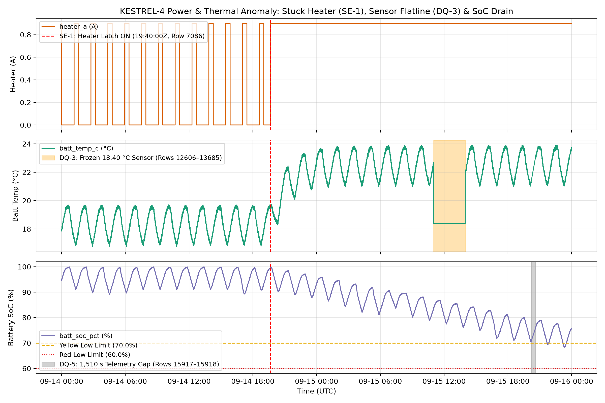
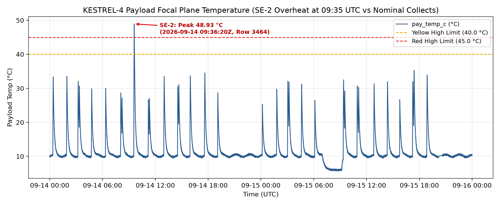
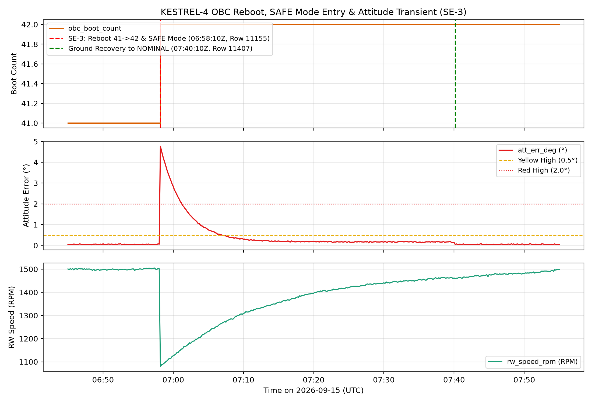

# KESTREL-4 Telemetry Analysis & Anomaly Report (Assignment B1)

**Author:** Bhagyashree Reddy  
**Dataset Window:** `2026-09-14 00:00:00 UTC` to `2026-09-16 00:00:00 UTC` (48 hours, nominal $10\text{ s}$ cadence)  
**Target Spacecraft:** KESTREL-4  

---

## 1. Project Overview

This repository contains the end-to-end housekeeping telemetry analysis, data-quality validation pipeline, anomaly report, and diagnostic plots for **KESTREL-4** (`Assignment B1`).

The goal of this project is to analyze 48 hours of raw spacecraft telemetry (`17,134` rows in `telemetry_48h.csv`) against the flight limit definitions in `tm_limits.yaml`, while strictly separating:
1. **Spacecraft Events (`SE-1` to `SE-4`):** Physical hardware or flight-software anomalies occurring onboard the satellite.
2. **Data-Quality Issues (`DQ-1` to `DQ-5`):** Ground-station recording glitches, out-of-order packets, telemetry dropouts, stuck/cached sensor buffers, and single-sample ADC bit-flips in the CSV dataset itself.

In accordance with operational data integrity rules, **`telemetry_48h.csv` is never modified by hand**. All deduplication, chronological sorting, and gap handling are performed purely in memory inside `b1_telemetry_analysis.py`.

---

## 2. Repository Structure

Every file in this repository maps directly to the B1 deliverables:

```text
B1-Pixxel-Space-Assignment/
├── b1_telemetry_analysis.py        # One-run Python script that cleans data, prints stats, and builds all PNG plots
├── B1-report.md                        # Complete written Anomaly Report & Decision Record (submitted on portal)
├── telemetry_48h.csv               # Raw 48-hour KESTREL-4 housekeeping telemetry dataset (17,134 rows, untouched)
├── tm_limits.yaml                  # Yellow/Red telemetry threshold definitions and 3-sample persistence rules
├── fig1_power_heater_soc.png       # Output Plot 1: Stuck battery heater (SE-1), sensor flatline (DQ-3) & SoC drain
├── fig2_payload_thermal_spike.png  # Output Plot 2: Payload focal-plane overheat (SE-2) vs nominal imaging runs
├── fig3_obc_reboot_safemode.png    # Output Plot 3: OBC watchdog reboot, SAFE mode entry & AOCS transient (SE-3)
└── README.md                       # Complete repository documentation and execution guide
```

---

## 3. How to Run the Script (One-Run Reproduction)

### Prerequisites
Make sure you have **Python 3.8+** installed along with `pandas`, `numpy`, and `matplotlib`:

```bash
python -m pip install pandas numpy matplotlib
```

### Execution
From inside the `B1-Pixxel-Space-Assignment` directory, run:

```bash
python b1_telemetry_analysis.py
```

### What Happens When You Run `b1_telemetry_analysis.py`:
1. **Loads Raw Data & Maps Excel Rows (`Step 1`):** Reads `telemetry_48h.csv` and creates an `excel_row = index + 2` column so every console printout matches the exact row number when inspecting the CSV in Excel or an IDE.
2. **Runs Raw Data-Quality Checks (`Step 2`):** Scans the untouched dataset to report duplicate timestamps (`DQ-1`) and backward timestamp steps (`DQ-2`).
3. **Cleans Data in Memory (`Step 3`):** Drops duplicate timestamps (`keep='first'`), sorts rows chronologically by `timestamp_utc`, detects the $1,510\text{ s}$ telemetry gap (`DQ-5`), and flags zero-variance frozen sensor runs (`DQ-3`).
4. **Computes Nominal Baselines (`Step 4`):** Uses the pre-anomaly window (`2026-09-14 00:00:00Z` to `19:39:50Z`) to compute orbital period ($95.11\text{ min}$), eclipse duration ($34.85\text{ min}$), battery SoC swing ($90.0\%$ to $99.7\%$), and nominal subsystem temperatures.
5. **Evaluates `tm_limits.yaml` with Persistence (`Step 5`):** Flags every Yellow and Red threshold crossing and classifies each excursion as either **Persistent ($\ge 3$ consecutive samples / $\ge 30\text{ s}$)** or **Transient ($< 3$ samples)**.
6. **Generates High-Resolution Plots (`Step 6`):** Automatically saves `fig1_power_heater_soc.png`, `fig2_payload_thermal_spike.png`, and `fig3_obc_reboot_safemode.png` at $200\text{ DPI}$.

---

## 4. Summary of Findings

### A. Nominal Baseline (Pre-Anomaly Orbits: `00:00:00Z` to `19:39:50Z` on Sept 14)
* **Orbit & Eclipse:** Mean orbit period is **$95.11\text{ min}$** ($95.00\text{ min}$ to $95.17\text{ min}$) with a **$34.85\text{ min}$** eclipse (**$36.64\%$** shadow fraction).
* **Power & Battery:** Solar array current (`sa_current_a`) averages **$2.05\text{ A}$** in sunlight and **$0.00\text{ A}$** in eclipse. Regulated main bus (`bus_voltage_v`) holds at **$27.88\text{ V}$ to $28.05\text{ V}$**. Battery state of charge (`batt_soc_pct`) cycles from **$\approx 99.7\%$** at eclipse entry to **$\approx 90.0\%$** at eclipse exit (**$9.32\%$** mean Depth of Discharge), recharging back to $\approx 99.7\%$ every sunlit pass.
* **Thermal & Heater:** Thermostat control turns `heater_a` ($0.9\text{ A}$) ON at `batt_temp_c` $\approx 17.3^\circ\text{C}$ and OFF at $\approx 17.9^\circ\text{C}$, maintaining `batt_temp_c` between **$16.75^\circ\text{C}$ and $19.71^\circ\text{C}$**. Nominal `obc_temp_c` is **$22.1^\circ\text{C}$ to $29.1^\circ\text{C}$**, and `pay_temp_c` idles at **$9.4^\circ\text{C}$ to $10.5^\circ\text{C}$** in `STANDBY` ($25.3^\circ\text{C}$ to $35.2^\circ\text{C}$ during normal $60\text{ s}$ to $180\text{ s}$ `IMAGING` collects).
* **AOCS, OBC & Memory:** Attitude error (`att_err_deg`) averages **$0.054^\circ$** ($< 0.10^\circ$), reaction wheel speed (`rw_speed_rpm`) stays within **$1,467\text{ rpm}$ to $1,575\text{ rpm}$**, body rates stay within **$\pm 0.05\text{ deg/s}$**, `obc_boot_count` is **$41$**, and `mem_used_pct` cycles between **$3.0\%$ and $27.75\%$**.

---

### B. Spacecraft Events (Physical / Onboard Anomalies)

| ID | Start & End UTC | CSV Rows | Parameters | Key Evidence & Root-Cause Hypothesis | Severity |
| :--- | :--- | :--- | :--- | :--- | :--- |
| **SE-1** | `2026-09-14T19:40:00Z` to `Ongoing at end of file` | Row `7086` to `17135` | `heater_a`, `batt_temp_c`, `batt_soc_pct`, `batt_voltage_v` | `heater_a` turns ON ($0.9\text{ A}$) at `batt_temp_c` $= 19.45^\circ\text{C}$ and stays latched ON for all $10,050$ remaining rows. Continuous $\approx 25\text{ W}$ load drains `batt_soc_pct` at $\approx 1.2\%/\text{orbit}$, crossing Yellow low ($70.0\%$) at Row `16308` and reaching **$68.33\%$** ($15.65\text{ V}$) at Row `16944`. Smooth temperature rise to $23.91^\circ\text{C}$ proves the thermistor works and the heater relay/thermostat latched closed. | **4 (Major)** |
| **SE-2** | `2026-09-14T09:33:30Z` to `2026-09-14T09:38:00Z` | Rows `3447` to `3465` | `pay_temp_c`, `pay_state` | During a $180\text{ s}$ `IMAGING` collect, `pay_temp_c` heats at $\approx 12.6^\circ\text{C/min}$ (vs nominal $8.0^\circ\text{C/min}$), crossing $40.0^\circ\text{C}$ (Yellow, Row `3456`) and $45.0^\circ\text{C}$ (Red, Row `3460`), peaking at **$48.93^\circ\text{C}$** (Row `3464`) before tripping to `STANDBY`. Subsequent $180\text{ s}$ collects peaked normally ($\le 35.24^\circ\text{C}$), pointing to a transient TEC cooler brownout or high-gain calibration mode. | **3 (Moderate)** |
| **SE-3** | `2026-09-15T06:58:10Z` to `2026-09-15T07:40:00Z` | Rows `11155` to `11407` | `obc_boot_count`, `mode`, `mem_used_pct`, `att_err_deg`, `rw_speed_rpm` | `obc_boot_count` increments $41 \rightarrow 42$, `mode` enters `SAFE`, volatile RAM clears (`mem_used_pct` drops $10.6\% \rightarrow 3.0\%$), `rw_speed_rpm` drops $1502 \rightarrow 1079\text{ rpm}$, and `att_err_deg` spikes to **$4.773^\circ$** (Red, $19$ samples). Pre-reset voltage ($27.95\text{ V}$) and OBC temp ($25.60^\circ\text{C}$) were nominal, indicating a Single-Event Upset (SEU) or unhandled software exception. | **4 (Major)** |
| **SE-4** | `2026-09-15T02:31:20Z` to `2026-09-15T02:31:30Z` | Rows `9554` to `9555` | `gyro_z_dps` | `gyro_z_dps` spikes to $1.1182\text{ deg/s}$ and $1.0764\text{ deg/s}$ for 2 samples ($20\text{ s}$) in eclipse, crossing Yellow high ($1.0\text{ deg/s}$) but staying below the 3-sample persistence rule while `att_err_deg` remained flat ($0.050^\circ$ to $0.059^\circ$). | **2 (Minor)** |

---

### C. Data-Quality Issues (Dataset / Sensor / Telemetry Glitches)

| ID | Time (UTC) | CSV Rows | Issue Description | How Handled in `b1_telemetry_analysis.py` |
| :--- | :--- | :--- | :--- | :--- |
| **DQ-1** | `2026-09-14 02:58:20Z` to `03:01:30Z` | Rows `1072-1073`, `1082-1083`, `1088-1089`, `1094-1095` | 4 duplicate timestamp pairs (2 exact row duplicates and 2 pairs with sub-second measurement jitter). | Removed duplicate timestamps via `drop_duplicates(subset=['timestamp_utc'], keep='first')` so $\Delta t = 0\text{ s}$ never causes divide-by-zero errors. |
| **DQ-2** | `2026-09-14 03:02:50Z` to `03:03:50Z` | Rows `1104` to `1108` | Out-of-order rows: `03:03:20Z` to `03:03:40Z` (Rows `1104-1106`) are stored before `03:03:00Z` to `03:03:10Z` (Rows `1107-1108`). | Sorted chronologically using `sort_values('timestamp_utc')`, restoring a continuous $10\text{ s}$ cadence with zero missing packets. |
| **DQ-3** | `2026-09-15 11:00:00Z` to `13:59:50Z` | Rows `12606` to `13685` | `batt_temp_c` freezes at **exact $18.40^\circ\text{C}$** ($\Delta T = 0.00^\circ\text{C}$) for $1,080$ samples ($3.0\text{ hours}$) while `heater_a` $= 0.9\text{ A}$, then jumps to $21.82^\circ\text{C}$ at Row `13686`. | Detected via zero-variance run check (`diff() == 0`), highlighted on `fig1_power_heater_soc.png`, and excluded from thermal slope math. |
| **DQ-4** | `2026-09-14 04:12:30Z`, `13:47:10Z`, `22:05:40Z`; `2026-09-15 18:20:00Z` | Rows `1521`, `4969`, `7960`, `15246` | Single-sample telemetry bit-flips: `bus_voltage_v` $= 27.41\text{ V}$ (Row `1521`) and $26.88\text{ V}$ Red (Row `15246`); `att_err_deg` $= 0.634^\circ$ (Row `4969`); `obc_temp_c` $= 46.21^\circ\text{C}$ (Row `7960`). | Filtered out by the 3-sample persistence rule (`persistence_samples: 3`) because a physical power bus or board cannot jump $1.05\text{ V}$ or $+21.2^\circ\text{C}$ and recover in $10\text{ s}$. |
| **DQ-5** | `2026-09-15 20:11:50Z` to `20:37:00Z` | Between Rows `15917` & `15918` | **$1,510\text{ s}$ ($25\text{ min } 10\text{ s}$) telemetry dropout** ($150$ missing samples) starting mid-pass over Svalbard (`rx_lock=1, tx_state=ON`). | Left un-interpolated to avoid inventing fake slopes across $25\text{ minutes}$; shaded in grey on `fig1_power_heater_soc.png`. |

---

## 5. Visual Walkthrough of Generated Plots

### Figure 1: Stuck Battery Heater (`SE-1`), Sensor Flatline (`DQ-3`) & Battery SoC Drain

* **Top Panel (`heater_a`):** Shows normal thermostat cycling between $0.0\text{ A}$ and $0.9\text{ A}$ until `2026-09-14 19:40:00 UTC` (Excel Row `7086`, red dashed line), where `heater_a` latches permanently at $0.9\text{ A}$.
* **Middle Panel (`batt_temp_c`):** Shows battery temperature shifting from its nominal $16.75^\circ\text{C}$--$19.71^\circ\text{C}$ band up to a $21.0^\circ\text{C}$--$23.9^\circ\text{C}$ plateau, along with the orange shaded 3-hour window (`Rows 12606-13685`) where the temperature reading froze at $18.40^\circ\text{C}$ (`DQ-3`).
* **Bottom Panel (`batt_soc_pct`):** Shows loss of power-positive operation after `19:40:00 UTC`, with peak SoC dropping $\approx 1.2\%$ per orbit until breaching the $70.0\%$ Yellow Low limit and reaching $68.33\%$. The grey shaded bar marks the $1,510\text{ s}$ telemetry gap (`DQ-5`).

---

### Figure 2: Payload Focal Plane Overheat (`SE-2`) vs Nominal Collects

* Tracks `pay_temp_c` across all 48 hours against the $40.0^\circ\text{C}$ Yellow High and $45.0^\circ\text{C}$ Red High limits.
* Highlights the `2026-09-14 09:33:30Z` imaging run (`SE-2`), which spiked to **$48.93^\circ\text{C}$** at Row `3464` before tripping back to `STANDBY`, whereas all 19 other imaging collects stayed safely below $35.24^\circ\text{C}$.

---

### Figure 3: OBC Watchdog Reboot, SAFE Mode Entry & Attitude Transient (`SE-3`)

* Zooms into `2026-09-15 06:45 UTC` to `07:55 UTC` around the unexpected reboot at Row `11155` (`06:58:10 UTC`).
* Shows `obc_boot_count` stepping from $41 \rightarrow 42$ (top), `att_err_deg` spiking to **$4.773^\circ$** above the $2.0^\circ$ Red limit (middle), and `rw_speed_rpm` dropping from $1,502\text{ rpm}$ to $1,079\text{ rpm}$ before recovering and returning to `NOMINAL` mode during the `07:40:10 UTC` ground pass (green dashed line).

---

*Bhagyashree Reddy · Pixxel Mission Operations · Assignment B1*
